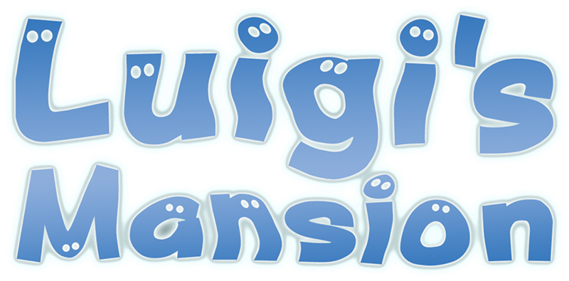

<div align=center>



</div>
<h1 align=center>Luigi's Mansion — Nintendo Switch port</h1>

A native Nintendo Switch port of the GameCube version of **Luigi's Mansion** (2001).

It's not an emulator. The PowerPC code of the game's `main.dol` is statically recompiled to C++ with
[Luigi's Mansion Recompiled](https://github.com/rob646464/luigis-mansion-recompiled) and compiled for the Switch and
the game is drawn by a native [deko3d](https://github.com/devkitPro/deko3d) renderer. It targets the game's original
**30 FPS at the console's stock clocks** with no overclock.

> [!NOTE]
> You need your own copy of the GameCube game: a disc image (`.iso`) or a compressed one (`.rvz`, `.wia`, `.gcz`,
> `.ciso`).

## Supported editions

One NRO for every edition: it runs the USA disc and the European disc adds content (the installer page checks your
discs automatically):

<div align="center">

| Disc | Edition | |
|---|---|---|
| `GLME01` | Luigi's Mansion (USA) | **Required**: it is the game the port runs |
| `GLMP01`, revision 0 | Luigi's Mansion (Europe), first release | Optional: adds the European **Hidden Mansion** and Spanish, German, French and Italian |

</div>

## How to install

1. Open the installer page: **https://stevensnd.github.io/lm-nx/**
2. Choose your disc images and press **Create lm-nx.zip**. Everything runs in your browser and the game files never
   leave your computer: the page checks your discs, downloads the game, compiles the shaders and, with both discs,
   builds the Hidden Mansion.
3. Extract the downloaded `lm-nx.zip` and copy its `LM-NX` folder into `sdmc:/switch/`.

Your `LM-NX` folder should look like this:

```text
/switch/LM-NX/
  LM-NX.nro
  pipelines.bin              (the list of graphics states the game prepares at start)
  orig/GLME01.iso            (your USA disc)
  orig/GLMP01.iso            (your European disc, optional)
  guardados/hidden_mansion/  (the Hidden Mansion, made from both discs)
  cache/                     (the shaders, compiled in your browser)
```

The game adds `settings.ini` (your settings), `logs/` and your saves in `guardados/` the first time it runs.

Launch with a game override (hold **R** while starting an installed title) or a forwarder. Album applet mode does
not provide enough memory.

I suggest using the latest version of [Sphaira](https://github.com/NaGaa95/sphaira) to generate the forwarder.

> [!NOTE]
> **Updating:** open the installer page again and press **Create lm-nx-update.zip**. It only has the game, the
> pipeline list and the shaders, so there is no need to copy your discs again: extract it and copy its `LM-NX` folder
> over your existing one. Your discs and your saves stay as they are.

> [!CAUTION]
> The shaders come ready in the package. **If they are missing**, the console compiles them on the first start with a
> progress bar, so that first start takes longer. See [Shaders](#shaders).

## Shaders

The game's graphics need shaders (small programs for the GPU), one for every graphics state the game uses: about
2,000 of them. Compiling them on the console takes a while, so **the installer page compiles them on your computer**
while it makes the package, using all the cores of your CPU (usually well under a minute), and puts them in the zip:

```text
/switch/LM-NX/cache/
  lmnx-tint-<id>/paquete.lmp           (the shaders translated to GLSL)
  lmnx-f447-gxabi2-<id>/paquete.lmp    (the shaders compiled for the Switch GPU)
```

With them the first start only loads the shaders, in a few seconds. `<id>` identifies the shader code of the game
version, so the shaders of one version are not used by another.

The console compiles the shaders itself, once, with a progress bar, when:

- the `cache/` folder is missing or was deleted;
- you updated `LM-NX.nro` by hand instead of with **lm-nx-update.zip** (the update zip always brings the matching
  shaders);
- the shader cache is damaged.

It happens only once: the compiled shaders are saved in `cache/` and later starts load them in seconds.
On a console at stock clocks it takes about 13 minutes.

## Controls

The Switch controller works as a GameCube controller:

<div align="center">

| Switch | GameCube |
| --- | --- |
| Left stick | Control stick |
| Right stick | C-stick |
| A / B / X / Y | A / B / X / Y |
| L or R | Z |
| ZL / ZR | L / R |
| + | START |
| D-pad | D-pad |

</div>

Every button can be remapped in the settings menu, and the sticks have dead zone, sensitivity and invert options.

## Settings menu

Press **both sticks at once (L3 + R3)** while playing to open it, and again to close it. It has tabs for the
graphics, the sound, the controls, the enhancements and the game options. Your changes are saved in
`settings.ini`, next to the NRO, when the menu closes.

## Resolution

**1280x720** in handheld mode and **1920x1080** docked.

## Performance

The port is made to run at the console's stock clocks **with no overclock**. The measured areas, such as the foyer
and the Master Bedroom, run at about 30 FPS.

<div align="center">

| Mode | CPU | GPU | Memory |
| --- | --- | --- | --- |
| Handheld | 1020 MHz | 460.8 MHz | 1331.2 MHz |
| Docked | 1020 MHz | 768 MHz | 1600 MHz |

</div>

> [!NOTE]
> The PGO profile is not complete. It comes from a short test on the console, done to check that PGO improves the
> port's performance, not from playing through the whole game.

## Overclocking

> [!CAUTION]
> Overclocking pushes the console beyond what it was designed for and you do it at your own risk. An unstable memory
> overclock can corrupt the NAND or the SD card: make a backup first and test every change.

These guides explain how to do it:

- **[How to get 60 FPS](https://rentry.org/howtoget60fps)**: the tools you need (Horizon OC, Ultrahand, Status
  Monitor...) and how to set them up.
- **[Mariko guide](https://rentry.co/mariko)**: overclocking the Switch V2, Lite and OLED.
- **[Erista guide](https://rentry.co/erista)**: overclocking the original 2017 Switch.
- **[How to test stability](https://rentry.co/howtoteststability)**: how to check that your CPU, GPU and memory clocks
  are stable.

In Horizon OC, set the clocks with **Edit App Profile** while the game is running. The App ID is the one of the game
you hold **R** on to launch it, or your forwarder's.

## How it works

- **The game's code is translated, not emulated.** The game's program (`main.dol`) is recompiled ahead of time to
  C++ and then compiled for the Switch's ARM CPU. The GameCube system the game expects (its SDK, files, audio DSP and
  controllers) is provided by high-level emulation (HLE) of those functions, built on
  [Luigi's Mansion Recompiled](https://github.com/rob646464/luigis-mansion-recompiled).
- **Its own renderer.** The game's GameCube graphics (GX) go through [Aurora](https://github.com/encounter/aurora),
  and this port draws them with deko3d, the Switch's native graphics API (`LMNX-Deko3D/`).
- **Shaders compiled in your browser.** Aurora turns every graphics state into a shader, Tint translates it to GLSL
  and uam compiles it for the Switch GPU. The installer page does all of this on your computer, so the first start
  on the console only loads them.
- **Optimization.** The code is built with LTO and PGO (profile guided optimization).

## Documentation

**Start with [docs/README.md](docs/README.md)**: it lists every document and explains the technical words in a
short glossary.

<div align="center">

| Document | What it explains |
| --- | --- |
| [docs/BUILDING_SWITCH.md](docs/BUILDING_SWITCH.md) | How to build the NRO, step by step |
| [docs/RECOMPILER.md](docs/RECOMPILER.md) | How the game's code is recompiled |
| [docs/RENDERING.md](docs/RENDERING.md) | How the game's graphics are drawn |
| [docs/AUDIO.md](docs/AUDIO.md) | The game's audio |
| [docs/CONTROLS.md](docs/CONTROLS.md) | The controls and the settings menu's Controls tab |
| [docs/HIDDEN_MANSION.md](docs/HIDDEN_MANSION.md) | How the European Hidden Mansion is built |
| [docs/PAL_PARITY.md](docs/PAL_PARITY.md) | The differences between the USA and European editions |
| [docs/PORTING.md](docs/PORTING.md) | Notes for porting it to other platforms |

</div>

## Build

devkitA64 and libnx from [devkitPro](https://devkitpro.org), Python, the third-party sources listed in
[docs/BUILDING_SWITCH.md](docs/BUILDING_SWITCH.md), and your own copy of the game for the code generator.

<div align="center">

| Folder | Contents |
| --- | --- |
| `src/` | The game side: recompiler runtime, HLE of the GameCube SDK, audio, settings menu |
| `platforms/switch/` | The Switch layer: memory, threads, input, start-up, logging |
| `LMNX-Deko3D/` | The deko3d renderer and its shader cache |
| `extern/aurora/`, `patches/` | Aurora and this port's changes to it |
| `tools/` | Code generation, build scripts and the tools of the installer page |
| `installer/` | The installer page (published at https://stevensnd.github.io/lm-nx/) |
| `docs/` | Documentation |

</div>

## Credits

- **Nintendo** — creators of Luigi's Mansion. This is an unofficial, fan-made port with no affiliation.
- **[rob646464](https://github.com/rob646464/luigis-mansion-recompiled)** — Luigi's Mansion Recompiled, the
  recompilation this port is based on.
- **[encounter](https://github.com/encounter/aurora)** — Aurora, the GameCube compatibility layer.
- **[TwilitRealm](https://github.com/TwilitRealm/dusklight)** — Dusklight: parts of JSystem and of the console's
  system code.
- **[centollOS](https://github.com/centollOS)** — [SwitchWaker](https://github.com/centollOS/SwitchWaker) and
  [SwitchWakerHD](https://github.com/centollOS/SwitchWakerHD): the deko3d renderer work, the SDL3 layer and the shader
  compiler patches this port adapts, together with **banjo-nx**.
- **[TP-Aleks](https://github.com/Alexgg1014/The-Legend-of-Zelda-Twilight-Princess-Alek-s-Ultimate-NX-Edition)** — the
  Switch build setup.
- **[fincs](https://github.com/fincs)**, **[devkitPro](https://devkitpro.org) and
  [switchbrew](https://github.com/switchbrew)** — [deko3d](https://github.com/devkitPro/deko3d),
  [uam](https://github.com/devkitPro/uam), devkitA64 and [libnx](https://github.com/switchbrew/libnx).
- **The [Dolphin](https://dolphin-emu.org) team** — the RVZ, WIA and GCZ formats the installer page reads.
- **PFRA** — Delfino, the font of the installer page.
- The other libraries listed in [THIRD_PARTY_NOTICES.md](THIRD_PARTY_NOTICES.md).

## Support

**[HERE](https://linktr.ee/stevensmods)** are my social media

If you enjoy my work and want to support me:

[](https://ko-fi.com/stevenss)

## Legal

No affiliation with Nintendo. "Luigi's Mansion", "Nintendo GameCube" and "Nintendo Switch" are trademarks of
Nintendo. This repository contains no game data and no game code generated from it. Users must provide their own
legally obtained copy, and the installer page makes the package from it on their own computer. Running homebrew
requires custom firmware, which violates Nintendo's ToS and can get a console banned — your call.

Source code is provided under the MIT License (see [LICENSE](LICENSE)). Third-party code keeps its own license (see
[THIRD_PARTY_NOTICES.md](THIRD_PARTY_NOTICES.md)).
